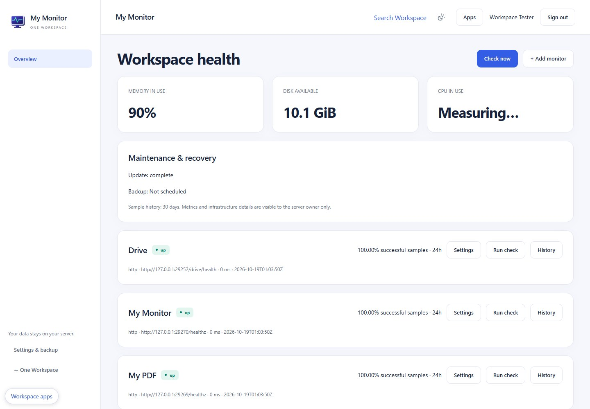

<p align="center"></p>

# My Monitor

Private health and incident monitoring for your Workspace host. An original Apache-2.0 One Workspace application; not an upstream fork.



## Windows download

Download the Windows x64 ZIP from [Releases](https://github.com/oneworkspacestudio/my-monitor/releases). Verify SHA256SUMS.txt, extract to a program folder and run **MyMonitor.exe**. No Docker, WSL, Node.js or Python is needed at runtime. A modern browser and a dedicated **NTFS** data folder are required. This is a **0.1.0-preview.1** release; unsigned Windows executables may prompt for trust.

The simplest managed installation is [One Workspace](https://github.com/oneworkspacestudio/one-workspace). New default apps are installed during manager updates unless explicitly excluded. Existing app data and user files are preserved.

## Included

Registry discovery; public HTTP(S)/TCP, discovered process and read-only Windows service checks; disk, RAM and sampled CPU; TLS expiry warnings; sample history and incidents; threshold, quiet period, acknowledgement and maintenance; encrypted HTTPS webhook configuration; opt-in safe status JSON.

## Standalone

```powershell
.\MyMonitor.exe --data C:\WorkspaceData\my-monitor --listen 127.0.0.1:8795
```

The app opens a one-time first-owner setup link. Choose your own password. Later starts reuse the same data folder. Keep private data separate from the executable and user-created files. Use a distinct port for each app. App Settings offers encrypted backup and account details; managed installations use MyAccounts automatically.

## Important limits

Infrastructure APIs are server-owner only. Uptime is the percentage of successful samples over 24 hours, not time-weighted SLA availability. Domain registration expiry and email alerts are not implemented. No remote agent or private-network scanning is enabled. Custom endpoints must resolve only to public addresses; exact registry endpoints are trusted separately. Status publishing is off by default.

See [operations and recovery](docs/OPERATIONS.md), [API contracts](docs/API.md), [acceptance evidence](docs/ACCEPTANCE.md), [architecture](docs/ARCHITECTURE.md) and [security](SECURITY.md). Preview status does not imply clean-machine, reboot, Windows-service or independent penetration-test certification.

## Build locally

Install PowerShell 7, Go 1.27.2 and Node.js 24+ for development only. Run `scripts/build.ps1 -Go <go.exe> -Npm <npm.cmd> -Release` from a clean committed checkout. The script uses pinned Go/npm dependencies, regenerates `.aui` UI, runs TypeScript, Go tests/vet and frontend contracts, builds the Windows icon/EXE, inventories dependency licenses and emits an immutable ZIP plus checksums. Browser tests: set APP_E2E_URL, APP_E2E_PASSWORD and run `npm run test:e2e` in web against disposable data.

No GitHub Actions are used. Distribution includes LICENSE, NOTICE, full dependency license texts, dependency inventory, compatibility and source build information. Source edits belong in `web/src/screens/*.aui`; generated React is reviewed and committed.
